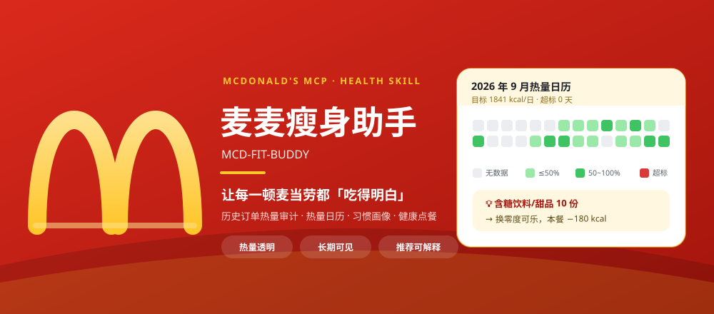
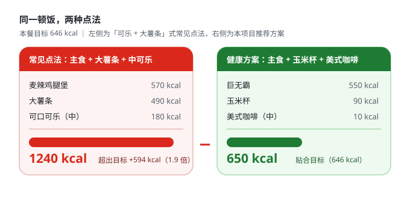
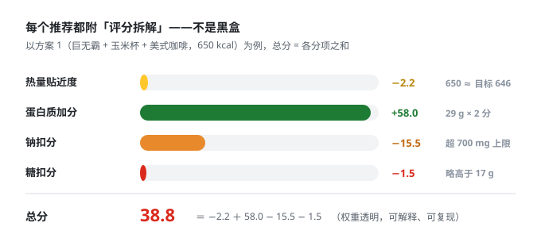
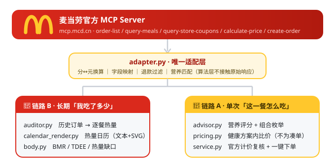

<div align="center">



**基于麦当劳 MCP 的健康点餐 Skill**

市面上的麦当劳工具都在回答「这一单怎么点最省」。  
**我们回答另一个没人管的问题：「你这一顿，吃了多少热量？」**


</div>

---

## 🎬 交互演示

打开 [`demo/index.html`](./demo/index.html)（纯静态页面，双击即可，无需任何服务），即可完整走一遍：

**身体指标 → 历史订单审计 → 热量日历 → 习惯画像 → 门店/菜单 → 营养评分方案 → 官方计价 → 确认下单**

- 门店、菜单（含官方商品图）、价格与可用券为 **2026-10-21 09:44 通过 `mcp.mcd.cn` 实时拉取的快照**，其中方案 1 的结算经过真实 `calculate-price` 复核（原价 ¥58.50 → 官方促销 ¥51.40）；
- 历史订单、热量审计与评分为本项目算法的真实计算结果（确定性样例，可复现）；
- 营养库未收录的餐品在演示中标记「热量未知」，**不估算、不参与推荐**；
- 演示**不会调用 `create-order`**，不产生真实订单。
- 数据由 `demo/build_demo_data.py` 生成（`python demo/build_demo_data.py`），改完算法可一键刷新。

---

## 为什么做这个

麦当劳是很多人的一日三餐，但**没有人替你算过它的热量账**：

- 点单页只有价格，没有热量；
- 券和套餐机制把你往「大分量」上推；
- 吃了一个月，你不知道自己吃了多少、哪几天超标、该改哪一样。

**麦麦瘦身助手**基于麦当劳官方 MCP，用两条链路回答这个问题：  
**链路 B** 回顾你到底吃了多少，**链路 A** 决定这一餐怎么吃更健康。

<table>  
<tr>  
<td width="50%">

### 🔗 链路 B · 长期「我吃了多少」

- 拉取 `order-list` **历史订单**，逐单、逐项匹配营养数据，算出**每餐吃了多少 kcal**
- 生成 **热量日历**（GitHub contributions 风格月历，超标日一眼可见）
- 还原 **饮食习惯画像**：最常点的单品、工作日 vs 周末差异、夜宵频次、含糖饮料占比
- 审计铁律：**退款不算吃**、**查不到热量的餐品绝不估算**

</td>  
<td width="50%">

### 🔗 链路 A · 单次「这一餐怎么吃」

- 结合《中国居民膳食指南（2022）》与 **身体指标**（Mifflin-St Jeor 估算 BMR/TDEE）
- 计算本餐热量目标（每日目标 ÷ 3，减脂默认 400 kcal 温和缺口）
- 对菜单做 **可解释的营养评分**，枚举「主食 + 小食 + 饮料」组合
- **健康优先，其次比价**：对入围健康方案再跑用券最优化（`calculate-price` 真实计价）
- 给出 **替换建议**：不改变你想吃的方向，只换更低热量的同类（可乐 → 零度可乐，−180 kcal）
- 确认后 **一键下单**

</td>  
</tr>  
</table>

<div align="center">

|     📊 热量日历     |    🧠 习惯画像   |   🥗 健康方案   |   💰 顺便比价   |       🔑 使用门槛      |
| :-------------: | :----------: | :---------: | :---------: | :----------------: |
| **月历 + SVG 导出** | **7 类可复现洞察** | **评分全部可解释** | **健康方案里再省** | **无 Token 可跑全部测试** |

</div>

---

## 一图看懂：同样是吃麦当劳，差距有多大

同一顿饭，「可乐 + 大薯条」式的常见点法直接吃掉 **1240 kcal**——接近本餐目标的 2 倍；  
而贴合目标的健康方案只要 **650 kcal**，还附带你为什么要选它的每一条理由。

<p align="center">  
    
</p>

推荐不是黑盒。每个方案都附带 `ScoreBreakdown` 评分拆解：热量贴近度、蛋白质加分、钠/糖扣分，权重透明、可解释、可复现——**用户要学会，而不是依赖**。

<p align="center">  
    
</p>

> 注意方案里没有「用生菜沙拉堆分」，也没有砍掉主食饿肚子——  
> 它在**热量贴合、蛋白质够、价格合理**之间取了平衡。

---

## 一个真实例子（离线样例数据，可复现）

**问「我最近吃麦麦吃得健康吗」** →

```text
用户画像：男 29 岁，173cm / 76kg，活动水平 light
BMR 1701 kcal ｜ TDEE 2339 kcal ｜ 每日目标 1939 kcal（缺口 400）｜ 本餐目标 646 kcal

【饮食习惯画像】
  · 你最常点「板烧鸡腿堡」（近 29 单中出现 7 次，单份 430 kcal）。
  · 平均每单 748 kcal，超过本餐目标 646 kcal。
  · 含糖饮料/甜品出现 10 份——这是最容易替换掉的热量来源。
  · 有 2 单在 21 点后下单（夜宵场景）。
  · 2 单含未收录热量的餐品，其热量未计入（宁缺毋滥，不估算）。

2026 年 9 月热量日历（目标 1939 kcal/日，* 表示超标）
一  二  三  四  五  六  日
07· 730   08· 750   09· 760   10·1.3k   11· 600   12·1.5k   13· 440
14·  -     15· 930   16·  -     17·  -     18·  -     19· 575   20·1.0k
...
```

**问「这一餐怎么吃」** →

```text
方案 1（评分 39）
  · 巨无霸          ¥25.50   550 kcal
  · 玉米杯          ¥9.00    90 kcal
  · 美式咖啡(中)    ¥11.50   10 kcal
  合计：650 kcal ｜ 蛋白质 29 g ｜ 钠 1010 mg ｜ 实付 ¥40.00
  ▸ 热量 650 kcal，贴合本餐目标 646 kcal。
  ▸ 蛋白质 29 g（供能比 18%），饱腹感更强。
  ▸ 钠 1010 mg，超过单餐参考上限 700 mg，建议当日清淡。
  ▸ 已比价：用「满 35 减 6」，¥46.00 → ¥40.00。
```

完整输出见 [`examples/demo_output.md`](./examples/demo_output.md)。

---

## 与「省钱类工具」的本质区别

省钱工具的目标函数是「实付最低」。本项目的目标函数是「**营养最优，其次比价**」——这个次序不能反：

| 常见做法       | 本项目的做法                       | 为什么                 |
| ---------- | ---------------------------- | ------------------- |
| 把「便宜」当唯一目标 | 热量贴合度是第一排序键                  | 便宜的方案往往是「大可乐 + 大薯条」 |
| 凑单触发满减     | **只在已选餐品内用券**，不为用券而凑单        | 凑单 = 买入多余热量         |
| 营养数字拍脑袋    | 本地营养库 + **查不到就标「未知」，绝不估算**   | 宁可少报，不可编造           |
| 推荐没有理由     | 每个方案附 `ScoreBreakdown` 拆解    | 用户要学会，而不是依赖         |
| 只看这一单      | 同时看**历史订单 + 习惯画像**           | 一次性工具看不出长期结构        |
| ——         | **热量日历**：把抽象的「吃多了」变成一张看得见的月历 | 可视化最有说服力            |

---

## 架构

算法层不接触 MCP 原始响应，因此不会出现「分当元」「退款算进消费」这类单位与口径错误。

<p align="center">  
    
</p>

---

## 目标用户

- **减脂期打工人**：午餐经常吃麦当劳，想知道怎么点不破功
- **想知道热量真相的人**：吃了很久，从没算过到底吃了多少
- **健康管理新手**：需要的是「替换建议」这种可执行的小改变，而不是膳食计划书
- **需要管住夜宵手的人**：热量日历让 21 点后那单变得肉眼可见

---

## 快速开始

### 1. 申请麦当劳 MCP Token

前往麦当劳 MCP 开放平台，手机号登录后在控制台激活并复制 MCP Token。

### 2. 配置 MCP 连接

本项目提供脱敏示例配置 [`mcp-config.example.json`](./mcp-config.example.json)：

```json
{
  "mcpServers": {
    "mcd-mcp": {
      "type": "streamablehttp",
      "url": "https://mcp.mcd.cn",
      "headers": {
        "Authorization": "Bearer ${MCD_MCP_TOKEN}"
      }
    }
  }
}
```

> ⚠️ 将 `${MCD_MCP_TOKEN}` 替换为你的真实 Token。**请勿把真实 Token 提交到任何公开仓库。**

### 3. 在 WorkBuddy 中启用

1. 左侧边栏【专家 · 技能 · 连接器】→【连接器】→【自定义连接器】→【配置 MCP】
2. 粘贴上面的 JSON（替换 Token），保存
3. 将 `mcd-mcp` 设为【启用】

### 4. 安装本 Skill

```bash
cp -r skill/mcd-fit-buddy ~/.workbuddy/skills/        # macOS / Linux
Copy-Item -Recurse skill\mcd-fit-buddy "$env:USERPROFILE\.workbuddy\skills\"  # Windows
```

### 5. 开始使用

在 WorkBuddy 里直接说：

> 我最近麦当劳吃得多，帮我看看吃得健康吗？  
> （生成热量日历 + 饮食习惯画像）

> 我在人民广场，中午想吃麦当劳，帮我配一餐 650 kcal 左右的，顺便用上我的券。  
> （营养评分推荐 + 比价 + 一键下单）

---

## 本地命令行

```bash
# 全流程演示（离线样例数据，无需 Token）
python -m src.mcd_fit.cli demo

# 热量审计报告 / 热量日历（导出 SVG 到 output/）
python -m src.mcd_fit.cli report
python -m src.mcd_fit.cli calendar --year 2026 --month 9

# 健康点餐推荐（可指定身体指标与预算）
python -m src.mcd_fit.cli advise --sex M --age 29 --height 173 --weight 76 --budget 40

# 实盘（需 MCD_MCP_TOKEN）
set MCD_MCP_TOKEN=your-token
python -m src.mcd_fit.cli advise --store 1234567 --auto-coupon
python -m src.mcd_fit.cli order --store 1234567 --confirm   # 一键下单（需显式确认）
```

---

## 项目结构

```text
mcd-fit-buddy/
├── assets/                        # README 配图（麦当劳风格 SVG）
├── demo/                          # ★ 交互演示页（纯静态 HTML + 数据构建脚本）
│   ├── index.html / styles.css / app.js
│   ├── data.js                    # 由 build_demo_data.py 生成
│   └── build_demo_data.py         # 调用项目算法 + MCP 快照生成演示数据
├── mcp-config.example.json        # 脱敏 MCP 配置示例
├── skill/mcd-fit-buddy/
│   ├── SKILL.md                   # Skill 定义与标准工作流
│   └── references/mcp-tools.md    # MCP 工具速查手册
├── src/mcd_fit/
│   ├── models.py                  # 数据模型（营养/订单/方案）
│   ├── nutrition_db.py            # ★ 营养参考库（宁缺毋滥）
│   ├── body.py                    # BMR/TDEE/热量缺口/膳食指南常量
│   ├── auditor.py                 # ★ 热量审计与习惯画像
│   ├── calendar_render.py         # ★ 热量日历（文本 + SVG）
│   ├── advisor.py                 # ★ 健康推荐引擎（可解释评分）
│   ├── pricing.py                 # 用券最优化（健康方案内比价）
│   ├── adapter.py                 # MCP 适配层（单位/字段/退款/营养匹配）
│   ├── mcp_client.py              # 极简 MCP 客户端（仅标准库）
│   ├── service.py                 # 编排层（实盘/离线自动降级）
│   ├── mock_data.py               # 确定性样例数据（5 周订单）
│   └── cli.py
├── tests/test_fit_buddy.py        # 29 项单测（离线可跑）
├── examples/demo_output.md        # demo 完整输出
└── output/                        # 热量日历 SVG 导出目录
```

## 运行测试

```bash
python -m unittest discover -s tests -v
```

29 项测试均为纯本地运行，**不需要 MCP Token**。实测调用契约（分/元单位、退款过滤、  
beType/beCode 绑定等 12 条踩坑记录）见 [`MCP_INTEGRATION.md`](./MCP_INTEGRATION.md)。

---

## 设计原则

1. **绝不估算营养** —— 查不到热量的餐品标记「未知」并单独计数，绝不编造一个看起来合理的数。
2. **健康优先，其次比价** —— 比价只发生在已通过营养评分的方案内部。
3. **不为用券而凑单** —— 凑单 = 买入多余热量，与本项目目标相反。
4. **推荐必须说清理由** —— 每个方案附带评分拆解与替换建议。
5. **退款不算吃** —— 历史订单中的整单退款一律过滤。
6. **下单必须显式确认** —— 一键下单前先官方计价复核，且需用户确认。
7. **不构成医疗建议** —— 所有数值为通用估算，孕产妇、慢病人群请遵医嘱。

## 免责声明

本项目为麦当劳程序员创意开发大赛参赛作品，由参赛者独立开发，**非麦当劳官方产品**。  
项目输出仅供参考，**不构成医疗、营养或其他专业建议**；餐品信息、营养与价格数据以麦当劳官方渠道实时公示为准。  
README 中的配图为项目自制示意图，风格致敬但与麦当劳官方无关。

## License

MIT
